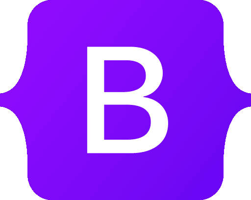

  

<h1 align="center">¡Hey 👋! Soy Steven Sol 🔆 </h1>

  <strong>Desarrollador Frontend</strong> apasionado por el desarrollo web y amante de JavaScript 💻❤️  
  ¡Gracias por visitar mi perfil!

  &nbsp;&nbsp;
  &nbsp;&nbsp;
  &nbsp;&nbsp;
  

## 👨‍💻 Sobre mí

Hola! Me llamo **Steven Sol**, tengo 25 años y soy un desarrollador frontend con más de 3 años de experiencia creando sitios y aplicaciones web. Me encanta aprender nuevas tecnologías y siempre estoy buscando mejorar mis habilidades. Me considero **autodidacta**, **curioso** y **apasionado** por la programación.

Además de programar, disfruto jugar videojuegos y explorar nuevas herramientas del ecosistema JavaScript.

## 🎯 Metas a Corto y Mediano Plazo

- ❌ Crear un canal de YouTube sobre desarrollo web  
- ✅ Conseguir trabajo en tecnología  
- ❌ Emprender un proyecto tecnológico  
- ✅ Convertirme en desarrollador Fullstack

## 🛠️ Tecnologías

  
  
  
  
  
  
  
  

## 🚀 Proyectos Destacados

Aquí algunos proyectos personales que he desarrollado. ¡Dales un vistazo! 👇

- 🔗 [To-Do List](https://to-do-list-q92hcxl54-steven55sol.vercel.app/)
- 🔗 [Pomodoro App](https://pomodoro-js-mauve.vercel.app/)
- 🔗 [Filtrado de Datos](https://filterdata4.netlify.app/)
- 🔗 [Lista de Tareas](https://listask.netlify.app)

Gracias por visitar mi perfil 💙 ¡Estoy abierto a colaborar o trabajar en nuevos retos!
